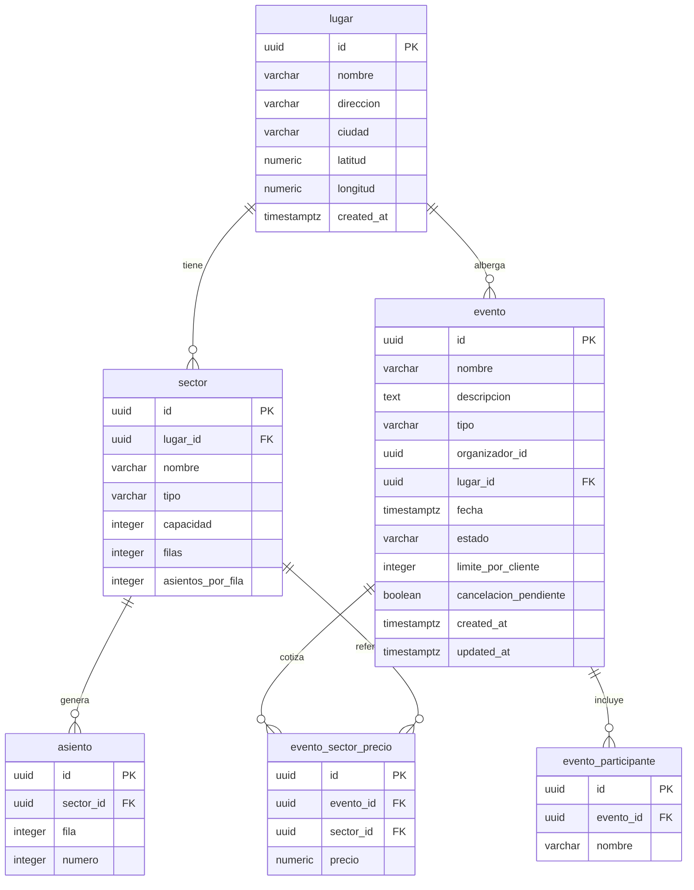

# Modelo de datos por microservicio

ER de las bases de la Entrega 1. Cada servicio es dueño de su esquema y no hay claves foráneas entre bases: la integración usa IDs y snapshots.

## 1. catalog-service (`catalog_db`)

Fuente de verdad: migraciones [`V1__init.sql`](../catalog-service/src/main/resources/db/migration/V1__init.sql), [`V3__evento_cancelacion_pendiente.sql`](../catalog-service/src/main/resources/db/migration/V3__evento_cancelacion_pendiente.sql) y [`V4__constraints_integridad.sql`](../catalog-service/src/main/resources/db/migration/V4__constraints_integridad.sql).

### Reglas y constraints

| Tabla | Clave / relación | Reglas en Flyway |
|---|---|---|
| `lugar` | `id` PK | `latitud` entre -90 y 90; `longitud` entre -180 y 180; textos no nulos |
| `sector` | `lugar_id` → `lugar.id` (`ON DELETE CASCADE`) | `tipo` en `NUMERADO`/`NO_NUMERADO`; `capacidad > 0`; `UNIQUE (lugar_id, nombre)`; numerados exigen `filas` y `asientos_por_fila` mayores a 0; no numerados los dejan en `NULL`; V4 exige `capacidad = filas * asientos_por_fila` para numerados |
| `asiento` | `sector_id` → `sector.id` (`ON DELETE CASCADE`) | `fila > 0`, `numero > 0`; `UNIQUE (sector_id, fila, numero)` |
| `evento` | `lugar_id` → `lugar.id`; `organizador_id` es un UUID externo | `tipo` en el enum de eventos (V4); `estado` en `BORRADOR`/`PUBLICADO`/`AGOTADO`/`CANCELADO`/`FINALIZADO`; `limite_por_cliente > 0`; `cancelacion_pendiente` default `false` |
| `evento_participante` | `evento_id` → `evento.id` (`ON DELETE CASCADE`) | `nombre` no nulo; índice por `(evento_id, nombre)` |
| `evento_sector_precio` | `evento_id` → `evento.id` (`ON DELETE CASCADE`); `sector_id` → `sector.id` | `precio >= 0`; `UNIQUE (evento_id, sector_id)` garantiza un precio por sector |

Índices: `idx_evento_busqueda` para búsqueda por estado/fecha/tipo/organizador/lugar y `idx_evento_cancelacion_pendiente` parcial para el scheduler.

### Entidades solapadas con otras bases

Catalog es dueño de estos IDs; inventory y orders guardan copias o referencias sin FK entre bases:

- `evento.id`: clave del snapshot de publicación en inventory y del snapshot de la orden.
- `sector.id` y `asiento.id`: referenciados por el inventario y por los ítems de la orden.
- `evento.nombre`, `evento.fecha`, `sector.id`, `asiento.id` y precio unitario: orders guarda un snapshot al crear la orden para validar devoluciones sin consultar catalog.
- `organizador_id`: se toma de `X-User-Id`; la identidad no vive en `catalog_db`.
- `lugar`, `sector`, `asiento`, `evento_participante` y `evento_sector_precio` son exclusivos de catalog.

### Validación contra el código

- Las entidades JPA de `catalog-service/src/main/java/.../dominio` mapean las mismas columnas (`ddl-auto: validate` en runtime).
- Se corrigió `Evento.updatedAt` para que `@PreUpdate` pueda persistir el cambio; antes la columna era `updatable = false` y quedaba congelada tras el alta.
- V4 refuerza en la base las reglas de `evento.tipo` y la capacidad de sectores numerados que antes solo validaba la aplicación.
- `EventoBusquedaIntegrationTest` valida el esquema real con PostgreSQL en CI (Testcontainers).

> Las secciones de `inventory-service` y `orders-service` se completan en sus PRs de Día 5 (tareas 3.8, 4.11 y 5.5).
